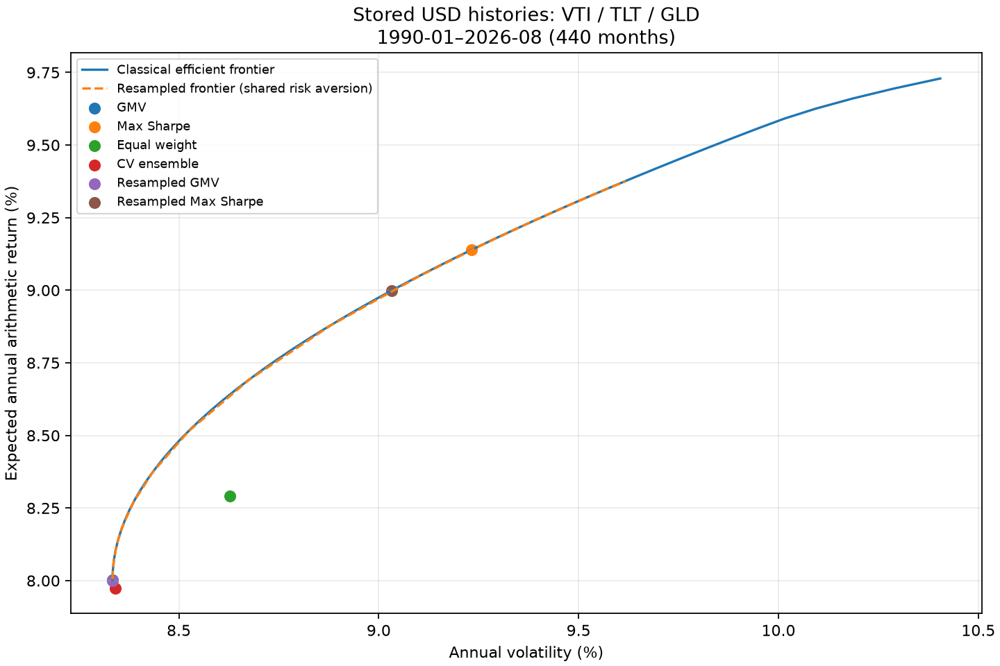
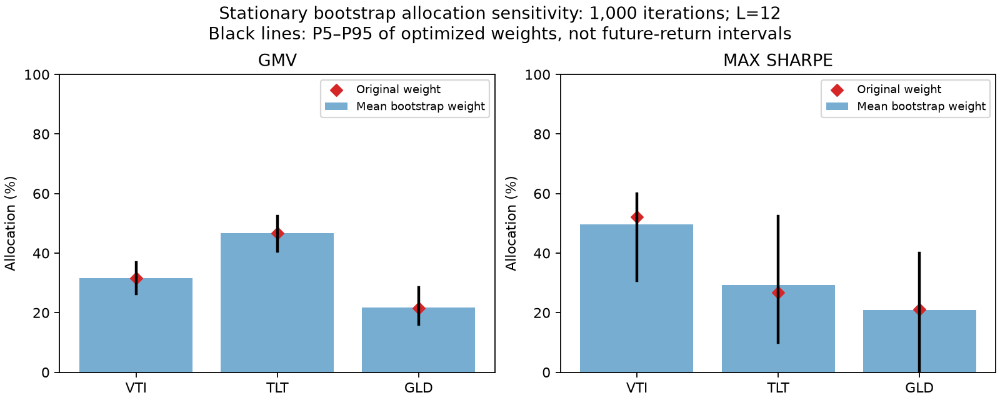

# Stored USD demonstration

Generated by `scripts/analytics_demo.py`. All observations come from the existing database. No synthetic or redownloaded histories.

Period: **1990-01 to 2026-08**, **440 months**. Annual risk-free rate: 3%.





## Portfolio comparison

| Portfolio | VTI | TLT | GLD | Expected return | Volatility | Sharpe | CAGR | Max drawdown |
|---|---:|---:|---:|---:|---:|---:|---:|---:|
| GMV | 31.68% | 46.69% | 21.63% | 8.00% | 8.33% | 0.600 | 7.93% | 24.43% |
| Max Sharpe | 52.17% | 26.79% | 21.05% | 9.14% | 9.23% | 0.665 | 9.07% | 23.15% |
| Equal weight | 33.33% | 33.33% | 33.33% | 8.29% | 8.63% | 0.613 | 8.22% | 21.53% |
| CV ensemble (full-sample) | 31.73% | 48.47% | 19.80% | 7.97% | 8.34% | 0.596 | 7.90% | 24.84% |
| Resampled gmv | 31.57% | 46.63% | 21.80% | 8.00% | 8.33% | 0.600 | 7.93% | 24.41% |
| Resampled max_sharpe | 49.69% | 29.38% | 20.92% | 9.00% | 9.03% | 0.664 | 8.94% | 23.13% |

CV ensemble and resampled statistics above use original full-sample estimates. They are not independent out-of-sample performance. The resampled portfolios are not assumed superior.

## Four-fold one-sided block validation

Sample sensitivity and allocation stability, not a historical investable backtest or independent forward out-of-sample performance. No embargo or purge gap.

Validation coverage: 440/440 (100.0%). Portfolio minimums: 120/60 months; covariance CV minimums: 60/30. Training samples across folds may overlap.

| Fold | Training months | Training interval | Direction | Validation interval | Months | VTI | TLT | GLD | Realized arithmetic return | Volatility | Sharpe |
|---|---:|---|---|---|---:|---:|---:|---:|---:|---:|---:|
| 1 | 330 | 1999-03–2026-08 | train_after_validation | 1990-01–1999-02 | 110 | 35.54% | 47.00% | 17.45% | 9.63% | 7.09% | 0.935 |
| 2 | 220 | 2008-05–2026-08 | train_after_validation | 1999-03–2008-04 | 110 | 37.74% | 43.80% | 18.47% | 7.45% | 6.38% | 0.697 |
| 3 | 220 | 1990-01–2008-04 | train_before_validation | 2008-05–2017-06 | 110 | 21.72% | 54.19% | 24.09% | 7.47% | 10.01% | 0.447 |
| 4 | 330 | 1990-01–2017-06 | train_before_validation | 2017-07–2026-08 | 110 | 31.92% | 48.87% | 19.21% | 7.27% | 10.56% | 0.405 |

CV stability:

```json
{
  "standard_deviation": {
    "1": 0.061396847564549994,
    "175": 0.03769472798732756,
    "243": 0.0255124575580548
  },
  "minimum": {
    "1": 0.2172247949899743,
    "175": 0.43797574205130596,
    "243": 0.17452901417434719
  },
  "maximum": {
    "1": 0.3773515012794085,
    "175": 0.5418807124886186,
    "243": 0.2408944925214073
  },
  "mean_absolute_weight_deviation": 0.03403580917912962,
  "maximum_weight_deviation": 0.10007857903219028,
  "mean_allocation_turnover_from_original": 0.05651396660966085,
  "lower_bound_frequency": {
    "1": 0.0,
    "175": 0.0,
    "243": 0.0
  },
  "upper_bound_frequency": {
    "1": 0.0,
    "175": 0.0,
    "243": 0.0
  }
}
```

## Bootstrap weight stability

### gmv

Requested: 1000; successful: 1000; failed: 0; status: complete.

| Asset | Original | Mean | Median | SD | P5 | P95 | Min | Max | Lower hit | Upper hit |
|---|---:|---:|---:|---:|---:|---:|---:|---:|---:|---:|
| VTI | 31.68% | 31.57% | 31.60% | 3.19% | 26.31% | 36.87% | 22.01% | 41.25% | 0.00% | 0.00% |
| TLT | 46.69% | 46.63% | 46.75% | 3.56% | 40.57% | 52.30% | 35.04% | 56.89% | 0.00% | 0.00% |
| GLD | 21.63% | 21.80% | 21.72% | 3.83% | 16.01% | 28.52% | 10.99% | 34.21% | 0.00% | 0.00% |

Allocation distance:

```json
{
  "mean": 0.04217564001434368,
  "median": 0.03860883063531542,
  "p5": 0.011245069538221693,
  "p95": 0.08469943900200416
}
```

### max_sharpe

Requested: 1000; successful: 1000; failed: 0; status: complete.

| Asset | Original | Mean | Median | SD | P5 | P95 | Min | Max | Lower hit | Upper hit |
|---|---:|---:|---:|---:|---:|---:|---:|---:|---:|---:|
| VTI | 52.17% | 49.69% | 51.24% | 10.37% | 30.69% | 60.00% | 0.00% | 60.00% | 0.10% | 0.00% |
| TLT | 26.79% | 29.38% | 29.21% | 13.99% | 10.00% | 52.40% | 10.00% | 70.00% | 14.90% | 0.10% |
| GLD | 21.05% | 20.92% | 21.45% | 12.24% | 0.00% | 40.00% | 0.00% | 40.00% | 6.20% | 0.00% |

Allocation distance:

```json
{
  "mean": 0.1535613823275259,
  "median": 0.1658800158248716,
  "p5": 0.04990037129586731,
  "p95": 0.27098844546440537
}
```

## Resampled frontier

250 requested samples; 250 successful; 0 failed; 51 shared risk-aversion points.

## Execution times

Numerical times (seconds):

```json
{
  "frontier_sample": 0.05848250000008193,
  "frontier_ledoit_wolf": 0.05187969999997222,
  "frontier_nonlinear": 0.043697599999632075,
  "frontier_cv_linear": 0.06850039999972068,
  "cross_validation": 0.01980230000026495,
  "bootstrap_1000_both_objectives": 8.447945299999901,
  "resampled_frontier_250x51": 8.628007599999819
}
```

Local FastAPI TestClient timings include actual spawned worker processes and polling, not external network latency:

```json
{
  "frontier": {
    "submit_seconds": 0.33520099999986996,
    "wall_seconds_including_polling": 2.7099969000000783,
    "job_seconds": 2.421770099999776,
    "retrieval_seconds": 0.0029595000000881555,
    "numerical_seconds": 0.06425840000019889
  },
  "cross-validation": {
    "submit_seconds": 0.165715199999795,
    "wall_seconds_including_polling": 2.4380889999997635,
    "job_seconds": 2.3247341000001143,
    "retrieval_seconds": 0.001987300000109826,
    "numerical_seconds": 0.033723900000040885
  },
  "bootstrap": {
    "submit_seconds": 0.16321130000005724,
    "wall_seconds_including_polling": 12.158866800000396,
    "job_seconds": 12.011815600000318,
    "retrieval_seconds": 0.03348000000005413,
    "numerical_seconds": 9.785083400000076
  },
  "resampled-frontier": {
    "submit_seconds": 0.5241089000001011,
    "wall_seconds_including_polling": 13.692871200000354,
    "job_seconds": 13.326961400000073,
    "retrieval_seconds": 0.03353340000012395,
    "numerical_seconds": 9.005602100000033
  }
}
```

## Data quality and provenance

- VTI contains historical reconstructions; detailed proxy transitions may be unknown.
- TLT contains historical reconstructions; detailed proxy transitions may be unknown.
- GLD contains historical reconstructions; detailed proxy transitions may be unknown.
- Selected series have unequal publication endpoints; the earliest is used.

Publication endpoints and reconstruction details are retained in each result's source metadata. High correlation alone does not establish a shared historical source.

Database byte hash unchanged: **True**.

SHA-256: `6ee0af74a349065b8c82adf4ea9f4b6cd42136d8c8c129cbd3a17351ca4dfdfe`.

Full per-iteration results, diagnostics, frontier points and estimator parameters are in the adjacent JSON artifacts. `openapi.json` contains all API request and response schemas.
